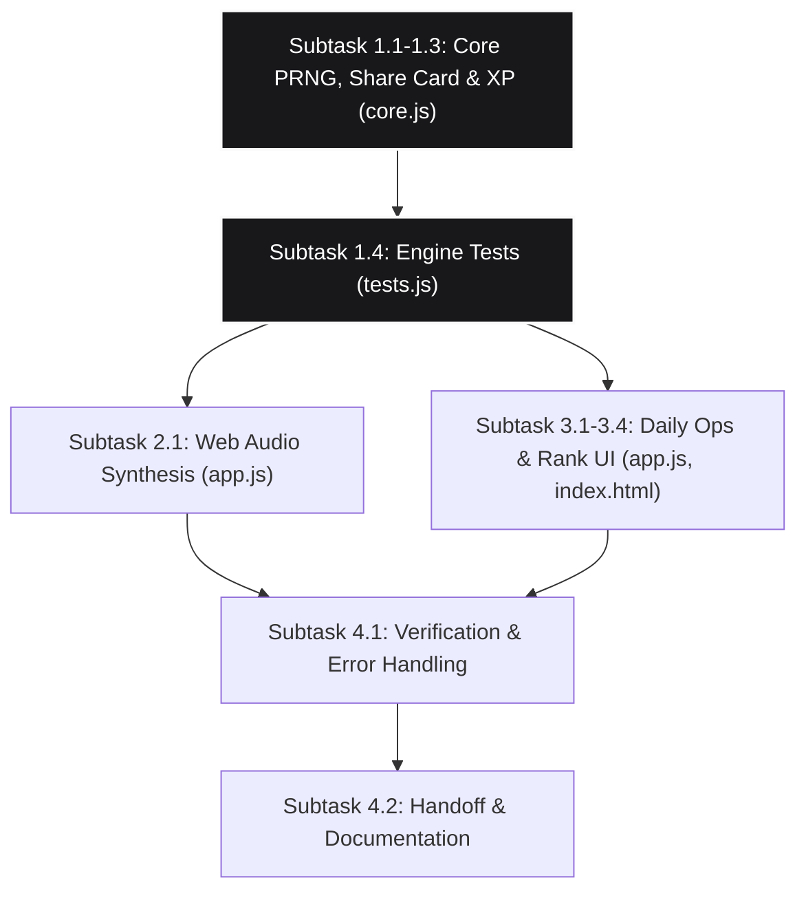

# Implementation Plan: Daily Flight Ops, Web Audio Synthesizer & Gamification Depth

This plan details the implementation of the pending EPIC for FlightCore: **Daily Flight Ops, Web Audio Synthesizer & Gamification Depth**. Scope is strictly confined to `D:\Documents\Personal_Project\Google_AG\FlightCore`.

## 1. Executive Summary & Epic Scope

This epic delivers three core capabilities prioritized in `ROADMAP.md` (Phase 1) and `RESEARCH_GAME_EXPANSION.md`:
1. **Zero-Dependency Web Audio Synthesizer**: Replaces the silent `playSound` stub with a pure Web Audio API synthesizer for tactile clicks, altitude chimes, success arpeggios, and error buzzes. Includes mute preference.
2. **Daily Flight Ops (Seeded Global Challenge)**: Generates a deterministic daily flight challenge from the UTC date (`YYYY-MM-DD`). Provides a shareable Wordle-style text score card with emoji blocks (`🟩🟨🟥`).
3. **Gamification Depth (XP & Cockpit Rank Progression)**: Calculates lifetime XP from accuracy and difficulty. Exposes rank titles from Rookie to Legend. Surfaces personalized skill weakness debriefs.

## 2. Token Conservation via OpenCode Delegation

To conserve tokens and reduce LLM cost, high-volume boilerplate and routine implementations are delegated to OpenCode powered by DeepSeek Flash via `delegate_opencode.ps1`. Antigravity orchestrates, validates git boundaries, runs regression tests, and inspects diffs.

| Subtask | Implementation Method | Target File(s) | Estimated Tokens Saved |
|---|---|---|---|
| 1.1 - 1.3: Core PRNG, Share Card & XP | OpenCode Delegation | `core.js` | ~25,000 |
| 1.4: Core Unit Tests | OpenCode Delegation | `tests.js` | ~20,000 |
| 2.1: Web Audio Synthesizer | OpenCode Delegation | `app.js` | ~20,000 |
| 3.1 - 3.4: DOM & UI Integration | OpenCode Delegation | `index.html`, `app.js`, `styles.css` | ~30,000 |
| 4.1 - 4.2: Verification & Review | Antigravity Native | `tests.js`, docs | Orchestrator Gate |

## 3. Topological Dependency Graph (DAG)

## 4. Decomposed Subtasks & Acceptance Criteria

### Phase 1: Pure Engine Logic (`core.js` & `tests.js`)
- **Subtask 1.1**: Deterministic PRNG (`mulberry32` or `splitmix32`) and Daily Flight Ops generator from UTC date string (`YYYY-MM-DD`). Generates 5 standardized module rounds.
- **Subtask 1.2**: Shareable Daily Ops score card formatter returning text with emoji grid (`🟩🟨🟥`), score, level, tier, and link.
- **Subtask 1.3**: Persistent XP formula and cockpit rank thresholds (`Rookie`, `Student Pilot`, `First Officer`, `Captain`, `Senior Captain`, `Ace`, `Legend`).
- **Subtask 1.4**: Unit tests in `tests.js` validating determinism across dates, share card format, and rank progression.
- *Validation*: `node tests.js` passes all tests.

### Phase 2: Tactile Web Audio Synthesizer (`app.js`)
- **Subtask 2.1**: Implement `WebAudioSynthesizer` in `app.js`:
  - `click`: 5ms high-frequency sine pop (1200Hz -> 400Hz).
  - `chime`: Dual-tone sine chime (800Hz + 1000Hz).
  - `success`: Ascending chord arpeggio (C5, E5, G5).
  - `error`: Low sawtooth buzz (120Hz).
  - Auto-unlock audio context on first user pointerdown/keydown gesture.
  - Respect mute preference (`flightcore_audio_muted`).
- *Validation*: `node --check app.js` passes without syntax errors.

### Phase 3: Daily Ops & Gamification UI (`index.html`, `app.js`, `styles.css`)
- **Subtask 3.1**: Daily Flight Ops launch button on home screen with date badge and one-attempt-per-day status.
- **Subtask 3.2**: "Share Result" button on debrief modal using `navigator.clipboard.writeText` with toast confirmation.
- **Subtask 3.3**: XP and Pilot Rank indicators on header/sidebar.
- **Subtask 3.4**: Audio mute toggle button/switch in settings panel.
- *Validation*: `node tests_app_error_handling.js` and local server checks.

### Phase 4: Verification & Handoff
- **Subtask 4.1**: Full test suite execution: `node tests.js` and `node tests_app_error_handling.js`.
- **Subtask 4.2**: Update `task.md`, `HANDOFF.md`, `SESSION_LOG.md`, and `README.md`.

## 5. Risk Assessment & Engineering Constraints

- **Audio Autoplay Restrictions**: Audio context must initialize exclusively inside user interaction handlers.
- **Zero External Dependencies**: All audio must be synthesized via pure Web Audio oscillators; no external sound files.
- **Deterministic Invariant**: Given the same UTC date string, `FlightCore.generateDailyChallenge` must yield identical module sequences and seeds on every machine.
